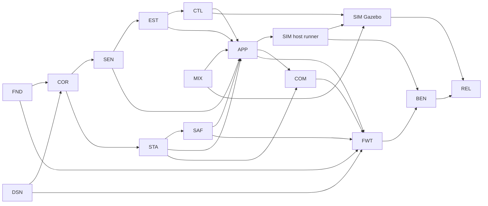

# DFCS Story Backlog

**Source of truth:** [Drone_Flight_Control_System_SRS.md](Drone_Flight_Control_System_SRS.md) (DFCS-SRS-001 v1.0)
**Scope:** POC only. No claim of flightworthiness (NFR-017). Simulation and propulsion-disabled bench only.

---

## 1. How to read this backlog

### 1.1 Ordering principle

Software and firmware that can be built and tested on a desktop host come first. Gazebo SITL follows. Target (STM32H743) firmware comes next. Work that needs physical hardware comes last.

| Wave | Content | Test environment | Needs hardware |
|---|---|---|---|
| 0 | Foundation, CI, design baselines | Host / CI | No |
| 1 | Portable core: sensors, estimator, state machine, safety, control, mixer, flight loop | Host (GoogleTest, Unity) | No |
| 2 | MAVLink handling, host SITL runner, mock simulator | Host (GoogleTest, pytest) | No |
| 3 | Gazebo Harmonic model and bridge, scenarios, tuning | SITL | No |
| 4 | Target firmware: cross-build, RTOS, HAL, drivers | Cross-compile, then target | Partly |
| 5 | Bench validation, HIL groundwork, release | Bench, CI | Yes |

Waves overlap. Dependencies, not wave numbers, decide what can start.

### 1.2 Sizing

Sizes are relative complexity, not time.

| Size | Meaning |
|---|---|
| **S** | One module or behavior, one test file, few interfaces touched. |
| **M** | One module with several behaviors, or a small cross-module integration. |
| **L** | Several modules, or an external tool or hardware dependency. Must list subtasks. |
| **XL or larger** | Not allowed. Split into S/M/L stories. |

### 1.3 Story rules

1. Each story is independently testable. Its "Done when" names the tests that prove it, using the `TC-<AREA>-NNN` convention.
2. Each story lists `Depends on` (hard blockers). A story may start once those are done, or faked through a port interface.
3. Subtasks (`ID.n`) exist only on L stories and where a story has distinct deliverables. They are not separately estimated or testable.
4. Stories do not invent gains, mixer coefficients, timing, or memory targets (SRS 7.5, 8). Where a value is needed, a decision or measurement story produces it.
5. Every story also meets the Definition of Done in SRS section 18.

### 1.4 Story format

> **Size** · **Priority** (SRS P0/P1) · **Reqs** · **Env** (test environment) · **Depends on**

### 1.5 Test ID areas

Areas `BOOT, SAFE, SENS, STATE, CTRL, MIX, COMM, SIM, CI` come from SRS 11.3. This backlog also proposes two new areas, `EST` (estimator) and `RTOS` (task timing and health). Add them to [tests/AGENTS.md](../tests/AGENTS.md) before use.

---

## 2. Epic overview

| Epic | Name | Stories | First wave |
|---|---|---|---|
| FND | Foundation, tooling, CI | 9 | 0 |
| DSN | Cross-cutting design baselines | 2 | 0 |
| COR | Core types, ports, faults, config | 5 | 1 |
| SEN | Sensor validation | 6 | 1 |
| EST | State estimation | 7 | 1 |
| STA | Flight-state management | 6 | 1 |
| SAF | Safety, failsafe, supervision | 7 | 1 |
| CTL | Attitude control | 4 | 1 |
| MIX | Quad-X mixer | 3 | 1 |
| APP | Flight loop integration | 2 | 1 |
| COM | MAVLink communication | 9 | 2 |
| SIM | Simulation and SITL | 15 | 2 to 3 |
| FWT | Target firmware | 24 | 4 |
| BEN | Bench and HIL groundwork | 9 | 5 |
| REL | CI extension, release, traceability | 7 | 2 to 5 |

### 2.1 Epic dependency graph

### 2.2 Suggested critical path

`FND-01 → FND-03 → COR-01 → COR-02 → SEN-05 → EST-04 → CTL-03 → APP-01 → SIM-04 → SIM-11 → SIM-12 → SIM-13`

Parallel lanes from Wave 1 on:
- State, safety, and failsafe: `STA-01 → SAF-01 → SAF-04`.
- Mixer: `MIX-01 → MIX-02 → MIX-03`.
- Target bring-up: `FWT-01 → FWT-04 → FWT-06`.

---

## 3. Stories

---

# Epic FND: Foundation, tooling, CI

### FND-01: Repository skeleton and host build of an empty core library
**S** · P0 · FR-070, NFR-010, AC-002 · Host · Depends on: none
- Create `firmware/core`, `tests/unit`, `tools`, and `cmake` layout per SRS Appendix A and [AGENTS.md](../AGENTS.md).
- Top-level CMake + Ninja builds an empty `dfcs_core` static library for the host.
- Done when: `TC-CI-004` shows a clean configure and build from scratch with documented commands.

### FND-02: Pinned toolchain manifest
**S** · P0 · NFR-010 · Host · Depends on: none
- Add `tools/toolchain.*` with exact versions for CMake, Ninja, GNU Arm toolchain, GoogleTest, Unity, Python, pytest, clang-format, clang-tidy, cppcheck, cmake-format, ruff, gcovr.
- Add a script that verifies installed versions against the manifest.
- Done when: the verify script fails on a version mismatch (negative test) and passes on a matching one.

### FND-03: Test harness smoke tests (GoogleTest, Unity, pytest)
**S** · P0 · NFR-010, FR-070 · Host · Depends on: FND-01, FND-02
- Wire GoogleTest (C++), Unity (C), and pytest. Add one trivial passing test per framework.
- Register all with CTest.
- Done when: `ctest` runs and reports all three frameworks.

### FND-04: Formatting and static-analysis configuration
**M** · P0 · NFR-012, NFR-014 · Host · Depends on: FND-01, FND-02
- Add `.clang-format`, `.clang-tidy`, cppcheck suppressions file, `cmake-format` config, and `ruff` config.
- Add a single `tools/check.sh` entry point that runs all of them.
- Subtasks:
  - FND-04.1: Agree the rule set (MISRA-informed, per SRS 13.3) and document it.
  - FND-04.2: Format and lint config files.
  - FND-04.3: `tools/check.sh` with non-zero exit on any violation.
- Done when: a deliberately violating sample file fails `check.sh`, and the clean tree passes.

### FND-05: Pull-request CI workflow (host)
**M** · P0 · NFR-014, NFR-010, SRS 12.1 · CI · Depends on: FND-03, FND-04
- GitHub Actions workflow runs on pull requests with pinned tool versions. Steps: format check, static analysis, host build, unit tests, test-report upload.
- Fails the pipeline on any mandatory failure.
- Done when: `TC-CI-003` confirms a format violation PR fails, and a clean PR passes.

### FND-06: Coverage report generation
**S** · P0 · SRS 12.1 item 6, 12.3 · CI · Depends on: FND-05
- Add a gcovr step to CI that publishes an HTML and XML report. No threshold yet (OD-012).
- Done when: the CI run attaches a coverage report artifact.

### FND-07: Portable-core boundary and banned-API check
**S** · P0 · NFR-008, NFR-005, NFR-001 · Host · Depends on: FND-04
- Script rejects STM32 HAL or FreeRTOS includes, heap use (`malloc`, `new`, `std::vector` growth), and blocking I/O (`printf`, `fopen`, sockets) in `firmware/core`.
- Add it to `tools/check.sh` and CI.
- Done when: `TC-CI-002` shows a seeded violation is caught for each rule class.

### FND-08: README disclaimer, RTM seed, and test-spec skeleton
**S** · P0 · NFR-017, NFR-011, AC-001 · Docs · Depends on: none
- Add an NFR-017 "not flight-ready" notice to the README.
- Create `docs/traceability/RTM.md` with the SRS 17 columns and the 6 seed rows.
- Create `docs/test-specifications/` skeleton.
- Done when: the RTM contains every FR/NFR ID with status `Planned`.

### FND-09: RTM consistency check
**S** · P0 · NFR-011, AC-001 · Host · Depends on: FND-03, FND-08
- A pytest script checks that every `TC-*` ID in test code exists in the RTM, and that every RTM row with status `Verified` has evidence.
- Done when: the test fails on an orphan test ID and on a `Verified` row without evidence.

---

# Epic DSN: Cross-cutting design baselines

### DSN-01: Core module interfaces and data ownership design
**M** · P0 · NFR-008, NFR-009, NFR-006, SRS 4.2 · Docs · Depends on: none
- Document module list, port interfaces (`IClock`, `IImu`, `IActuator`, and others), data-flow per SRS 4.3, and which module owns each mutable datum.
- Define the single deterministic entry point (`step(now)`) used by host, SITL, and RTOS builds.
- Subtasks:
  - DSN-01.1: Module and interface diagram.
  - DSN-01.2: Ownership table.
  - DSN-01.3: Error and fault reporting convention.
- Done when: design review is recorded, and the RTM maps NFR-008 and NFR-009 to the design sections.

### DSN-02: Task, timing, and WCET analysis approach
**M** · P0 · NFR-002, NFR-004 · Docs · Depends on: DSN-01
- Define the task list, ownership, synchronization primitives, and the measurement and WCET method.
- Leave periods, priorities, stack sizes, and deadlines as `TBD (measured)`. Do not invent them (OD-005, OD-012).
- Done when: design review is recorded, and a table of every value to be baselined and the story that will produce it exists (FWT-19, BEN-09).

---

# Epic COR: Core types, ports, faults, config

### COR-01: Time and sample types
**S** · P0 · FR-011 · Host · Depends on: FND-03, DSN-01
- Monotonic timestamp type, timestamped IMU sample, and units documented in the types.
- Provide an `IClock` interface and a controllable fake clock.
- Done when: unit tests show the fake clock is monotonic and that wrap or regress is detected.

### COR-02: Port interfaces and test fakes
**M** · P0 · FR-010, FR-071, NFR-008 · Host · Depends on: COR-01
- Pure interfaces: `IImu`, `IActuator` (four logical channels), `IClock`, `IFaultSink`.
- Fakes with scripted data and fault injection hooks.
- Subtasks:
  - COR-02.1: `IImu` + `FakeImu`.
  - COR-02.2: `IActuator` + `FakeActuator` that records commands.
  - COR-02.3: Contract tests every implementation (fake, sim, HAL) must pass later.
- Done when: the contract tests pass against the fakes and the core builds with no platform headers (FND-07 clean).

### COR-03: Fault and diagnostic registry
**M** · P0 · FR-013, FR-066, FR-004, NFR-013 · Host · Depends on: COR-01
- Fault code enum, severity, and a class mapping used by failsafe (SAF-03).
- Fixed-capacity active-fault set with set, clear, and query.
- Done when: unit tests cover set, clear, latching, capacity bound, and duplicate-report handling.

### COR-04: Configuration container and versioning
**S** · P1 · FR-017, FR-023, FR-047 · Host · Depends on: COR-01
- Plain-data config structs per module, with a version field and a validate hook.
- Configuration is loaded from outside application logic. No default values for gains or limits are baked in beyond a documented "unconfigured, inhibit" state.
- Done when: unit tests show an unversioned or invalid config is rejected and the system stays inhibited.

### COR-05: Fixed-capacity containers
**S** · P0 · NFR-005, NFR-001 · Host · Depends on: FND-03
- Ring buffer and fixed array queue with no heap use.
- Done when: unit tests cover full, empty, wrap, and overflow behavior.

---

# Epic SEN: Sensor validation

### SEN-01: IMU range validation
**S** · P0 · FR-012 · Host · Depends on: COR-02, COR-04
- Validate angular rate and acceleration against configured ranges.
- Done when: `TC-SENS-002` shows out-of-range samples are flagged, and in-range samples pass at the boundary values.

### SEN-02: IMU freshness validation
**S** · P0 · FR-011, FR-012 · Host · Depends on: COR-01, COR-02
- Flag samples older than a configured maximum age, and a missing sample sequence.
- Done when: `TC-SENS-001` shows a stale sample is rejected.

### SEN-03: IMU plausibility checks
**S** · P0 · FR-012 · Host · Depends on: COR-02
- Reject NaN or infinite values, stuck values over a configured count, and spikes beyond a configured step.
- Done when: `TC-SENS-003` covers each case.

### SEN-04: Sensor communication error detection
**S** · P0 · FR-013 · Host · Depends on: COR-02, COR-03
- Driver-reported errors and timeouts raise a diagnostic fault.
- Done when: `TC-SENS-004` shows an injected bus error produces the fault code and clears per policy.

### SEN-05: Sensor validator pipeline
**S** · P0 · FR-012, FR-041 · Host · Depends on: SEN-01, SEN-02, SEN-03, SEN-04
- Combine checks into one `validate()` that returns a validated sample plus health status. Control code receives only validated data.
- Done when: `TC-SENS-005` shows each failure class yields "invalid" and a correct reason.

### SEN-06: Baro, magnetometer, and GNSS interfaces and validation
**M** · P1 · FR-014, FR-015, FR-016 · Host · Depends on: COR-02, SEN-05
- Add `IBaro`, `IMag`, and `IGnss` ports, fakes, and the same validation classes as the IMU.
- Done when: `TC-SENS-006` covers range, freshness, and plausibility for each.

---

# Epic EST: State estimation

### EST-01: Attitude algorithm selection (spike)
**S** · P0 · OD-006 · Host · Depends on: DSN-01
- Compare candidate algorithms on synthetic IMU data. Record the choice, rationale, and rejected options in a design note.
- Done when: a design note is reviewed, and OD-006 is closed in the SRS risk table.

### EST-02: Estimator interface with validity and health
**S** · P0 · FR-021 · Host · Depends on: COR-02, SEN-05
- Define the estimator output: attitude, validity flag, health status, and timestamp.
- Done when: `TC-EST-001` shows output always carries validity and health.

### EST-03: Quaternion and vector math
**S** · P0 · FR-020 · Host · Depends on: FND-03
- Allocation-free quaternion and vector helpers, including Euler conversion.
- Done when: `TC-EST-002` passes against known analytic cases and singularity handling.

### EST-04: Attitude estimation algorithm
**M** · P0 · FR-020 · Host · Depends on: EST-01, EST-02, EST-03
- Implement the chosen algorithm using validated IMU data.
- Done when: `TC-EST-003` shows convergence to a known static attitude and tracking of a synthetic rotation within a tolerance set from the EST-01 analysis.

### EST-05: Estimator input-fault handling
**S** · P0 · FR-022 · Host · Depends on: EST-02, EST-04
- Missing, stale, or invalid mandatory input marks output invalid. Recovery requires valid data again.
- Done when: `TC-EST-004` covers missing, stale, and invalid input.

### EST-06: Estimator configuration
**S** · P1 · FR-023 · Host · Depends on: COR-04, EST-04
- Estimator parameters come from config only.
- Done when: `TC-EST-005` shows a changed config changes behavior with no code change, and an invalid config is rejected.

### EST-07: Altitude estimate from barometer
**M** · P1 · FR-024 · Host · Depends on: SEN-06, EST-04
- Altitude estimate enabled by config, with validity and health.
- Done when: `TC-EST-006` shows a synthetic climb is tracked, and loss of baro marks altitude invalid without affecting attitude validity.

---

# Epic STA: Flight-state management

### STA-01: States and transition table
**M** · P0 · FR-030, FR-031 · Host · Depends on: DSN-01, FND-03
- Implement BOOT, INITIALIZING, DISARMED, ARMED, FAILSAFE, FAULT with a data-driven transition table matching SRS 10.
- State changes only through the table.
- Done when: `TC-STATE-002` covers every permitted transition, and `TC-STATE-003` shows every non-permitted (state, event) pair is rejected without a state change.

### STA-02: Pre-arm checks and arming rejection
**M** · P0 · FR-032 · Host · Depends on: STA-01, SEN-05, EST-02, COR-03
- Pluggable pre-arm check list (sensor valid, estimator valid, no active critical fault, and others).
- Rejection returns a specific reason.
- Done when: `TC-STATE-001` shows arming is rejected for each failed precondition individually, and accepted only when all pass.

### STA-03: Disarm handling
**S** · P0 · FR-034 · Host · Depends on: STA-01
- A valid disarm moves ARMED to DISARMED and signals the safety gate to inhibit.
- Done when: `TC-STATE-004` shows disarm from ARMED works, and disarm from a non-ARMED state is handled without side effects.

### STA-04: Supported-mode registry and mode validation
**S** · P0 · FR-033, FR-036 · Host · Depends on: STA-01
- Registry lists only implemented modes. Unsupported or invalid mode commands are rejected.
- Done when: `TC-STATE-005` shows unsupported modes are rejected and not advertised.

### STA-05: Initialization sequencer and init-failure FAULT
**M** · P0 · FR-001, FR-003, FR-002 · Host · Depends on: STA-01, COR-03
- Ordered init steps behind an interface (clock, memory, peripherals, RTOS, application are stubbed on host). A mandatory step failure goes to FAULT.
- Outputs stay inhibited throughout.
- Done when: `TC-BOOT-002` shows a failure at each step reaches FAULT, and `TC-BOOT-003` shows the step order is enforced.

### STA-06: State and rejection-reason status snapshot
**S** · P1 · FR-035, FR-053 · Host · Depends on: STA-02, STA-04, COR-03
- Read-only snapshot with state, mode, last rejection reason, and active faults, for telemetry and diagnostics.
- Done when: `TC-STATE-006` shows the snapshot matches state and reason after each scripted event.

---

# Epic SAF: Safety, failsafe, supervision

### SAF-01: Safety output gate
**M** · P0 · FR-002, FR-046, FR-061, SRS 4.3 · Host · Depends on: COR-02, STA-01
- The gate sits between the mixer and `IActuator`. Default state is inhibited. It is inhibited in BOOT, INITIALIZING, DISARMED, FAULT, and on invalid control input.
- It can inhibit independently of the control calculation.
- Done when: `TC-BOOT-001` shows outputs are inhibited from reset, and `TC-SAFE-002` shows an inhibit overrides any controller output.

### SAF-02: Mandatory control-input staleness detector
**S** · P0 · FR-062 · Host · Depends on: COR-01, COR-03
- Track last-update age for each mandatory control input, with a configured timeout. Raise a fault on loss.
- Done when: `TC-SAFE-003` covers the fresh, stale, and recovered cases.

### SAF-03: Failsafe policy and fault-class table (design)
**M** · P0 · FR-063, FR-066 · Docs · Depends on: COR-03, STA-01
- Safety analysis document. For each fault class, define the detection, target state (FAILSAFE or FAULT), and actuator response. Do not assume that a generic motor stop is safe (SRS 7.7).
- Initial acceptance scope is simulation and propulsion-disabled bench only.
- Done when: a review is recorded, and every fault code in COR-03 maps to exactly one class.

### SAF-04: Failsafe transitions and per-class response
**M** · P0 · FR-063, FR-066 · Host · Depends on: SAF-01, SAF-02, SAF-03, STA-01
- Implement the table from SAF-03 on top of the state machine and gate.
- Done when: `TC-SAFE-004` shows each fault class yields the documented state and output, deterministically.

### SAF-05: Recovery rules with no automatic re-arm
**S** · P0 · FR-067 · Host · Depends on: SAF-04, STA-03
- Recovery to DISARMED needs a cleared fault and an explicit recovery acceptance. The system never goes to ARMED automatically.
- Done when: `TC-STATE-007` shows that fault clearing alone never re-arms, and that recovery without the explicit action is rejected.

### SAF-06: Task-health supervisor logic
**M** · P0 · FR-064 · Host · Depends on: COR-01, COR-03
- Portable supervisor. Tasks report heartbeats against configured deadlines. The supervisor decides "healthy" or "failed" and reports a fault.
- The watchdog kick decision lives here. The IWDG hardware call is a port (FWT-18).
- Done when: `TC-SAFE-005` covers a missed heartbeat, a late heartbeat, and recovery. The watchdog is not kicked while any supervised task is failed.

### SAF-07: Battery threshold monitor
**S** · P1 · FR-065 · Host · Depends on: COR-03, COR-04
- Compare battery voltage against configured thresholds and raise a fault. Thresholds come from config (OD-014), not from code.
- Done when: `TC-SAFE-006` covers below, at, and above each threshold, including hysteresis if configured.

---

# Epic CTL: Attitude control

### CTL-01: PID controller
**S** · P0 · FR-040 · Host · Depends on: FND-03
- A single-axis PID with configurable gains and a fixed-step `update(dt)`.
- Done when: `TC-CTRL-002` matches reference responses for P, I, and D separately.

### CTL-02: Output limits and anti-windup
**S** · P0 · FR-042 · Host · Depends on: CTL-01
- Configured output limits and anti-windup in the integrator.
- Done when: `TC-CTRL-001` shows output stays inside limits, and `TC-CTRL-003` shows the integrator does not wind up under sustained saturation.

### CTL-03: Attitude controller with input gating
**M** · P0 · FR-040, FR-041, FR-046 · Host · Depends on: CTL-02, EST-02, COR-04
- Roll, pitch, and yaw axes from estimated state and a validated setpoint.
- Invalid estimate or setpoint produces an "invalid" output and resets the integrators.
- Done when: `TC-CTRL-004` shows invalid inputs never produce a usable command.

### CTL-04: Controller config validation and versioning
**S** · P1 · FR-047 · Host · Depends on: CTL-03, COR-04
- Reject unversioned, out-of-bounds, or inconsistent gains and limits. Expose the active config version.
- Done when: `TC-CTRL-005` shows invalid configs are rejected and the version is reported.

---

# Epic MIX: Quad-X mixer

### MIX-01: Quad-X motor numbering and rotation decision
**S** · P0 · FR-045, OD-009 · Docs · Depends on: none
- Freeze and document motor numbering, rotation directions, and sign convention in a configuration-controlled document.
- Done when: the document is reviewed and the RTM maps FR-045 to it.

### MIX-02: Quad-X mixer
**M** · P0 · FR-043, FR-045 · Host · Depends on: MIX-01, COR-04
- Map roll, pitch, yaw, and throttle demands to four motor commands. The mixing matrix and motor order are configuration data, not inline.
- Done when: `TC-MIX-001` verifies the mapping per axis against MIX-01, and `TC-MIX-003` shows changing config changes order or sign with no code change.

### MIX-03: Output bounding and saturation handling
**S** · P0 · FR-044 · Host · Depends on: MIX-02
- Bound every motor command to configured limits. Document and implement the saturation strategy.
- Done when: `TC-MIX-002` shows outputs never leave bounds for extreme inputs.

---

# Epic APP: Flight loop integration

### APP-01: Portable flight loop pipeline
**M** · P0 · SRS 4.3, FR-070 · Host · Depends on: SEN-05, EST-05, CTL-03, MIX-03, SAF-01, STA-05
- `step(now)` runs: sensors, validation, estimator, state manager and controller, safety gate, mixer, actuator.
- Uses only ports. Runs on the host with fakes.
- Done when: an integration test shows end-to-end data flow with fakes, and that all output passes the gate.

### APP-02: Host fault-injection integration tests
**M** · P0 · FR-012, FR-022, FR-063, FR-067 · Host · Depends on: APP-01, SAF-04, SAF-05
- Scripted scenarios on the fake ports: sensor stale, sensor error, estimator invalid, failsafe, recovery, and disarm.
- Done when: the tests cover SRS 11.2 areas 1 to 8 and pass in CI.

---

# Epic COM: MAVLink communication

### COM-01: MAVLink message and command subset (decision)
**S** · P0 · OD-010, FR-051, FR-036 · Docs · Depends on: STA-04
- List supported messages and commands (for example HEARTBEAT and arm/disarm). Everything else is unsupported.
- Done when: the list is reviewed and published, and is used as the test oracle for COM-04 to COM-06.

### COM-02: MAVLink 2 library vendoring and pinning
**S** · P0 · NFR-010, SRS 13.2 · Host · Depends on: FND-02
- Vendor or fetch the pinned MAVLink 2 headers. Record version and hash.
- Done when: a build includes the library and CI verifies the pinned hash.

### COM-03: Byte-stream transport port with bounded RX buffer
**S** · P1 · FR-050, FR-055 · Host · Depends on: COR-05
- A transport interface (`read`, `write`) that never blocks. RX buffer is bounded and overflow is counted.
- Done when: unit tests cover partial reads, full buffers, and overflow handling.

### COM-04: Frame parser with validation
**M** · P0 · FR-051, NFR-016 · Host · Depends on: COM-01, COM-02, COM-03
- Parse only supported messages. Validate length, source, checksum, and field ranges. Bounded work per call.
- Done when: `TC-COMM-002` shows bad length, bad checksum, unknown source, and unsupported ID are all dropped safely.

### COM-05: Command handler
**M** · P0 · FR-054, FR-051, FR-032, FR-034 · Host · Depends on: COM-04, STA-02, STA-03, STA-04
- Validate command parameters. Route arm, disarm, and mode to the state manager. Unsupported commands are rejected with no change to actuator state.
- Done when: `TC-COMM-001` shows an unsupported command is rejected with actuator state unchanged, and arm with failed pre-arm checks is rejected.

### COM-06: Malformed and fuzz input suite
**M** · P0 · NFR-016, FR-054 · Host · Depends on: COM-04, COM-05
- Table-driven malformed cases and a bounded, seeded fuzz run (pytest or libFuzzer).
- Done when: `TC-COMM-003` runs with no crash or hang, no out-of-bounds access (sanitizers), and no actuator change.

### COM-07: Heartbeat and status telemetry
**M** · P1 · FR-052, FR-053, FR-035 · Host · Depends on: COM-02, STA-06, COR-03
- Encode HEARTBEAT and a status message from the status snapshot. Advertise only supported modes.
- Done when: `TC-COMM-004` shows the messages decode correctly and the content matches the snapshot.

### COM-08: Link-loss detection
**S** · P0 · FR-062, FR-054 · Host · Depends on: COM-04, SAF-02
- Feed a "last valid message" timestamp into the SAF-02 detector. Whether link loss is a critical fault is set by SAF-03.
- Done when: `TC-COMM-005` shows link loss raises the configured fault, and malformed frames do not reset the timer.

### COM-09: MAVLink signing evaluation
**S** · P1 · FR-056 · Docs · Depends on: COM-02
- Design note evaluating signing or another authenticated channel and key handling (no keys in source control).
- Done when: a design review is recorded with a decision and a deferral if applicable.

---

# Epic SIM: Simulation and SITL

### SIM-01: Bridge interface control document
**M** · P0 · FR-072, SRS 9.4, OD-011 · Docs · Depends on: DSN-01
- Define transport, message types, units, coordinate frames (for example ENU vs NED, FLU vs FRD), timestamps, update rates, and failure behavior.
- Done when: the document is reviewed, and every field has a unit and a frame.

### SIM-02: Frame and unit conversion library
**M** · P0 · FR-072, SRS 9.4 · Host · Depends on: SIM-01
- Conversions between Gazebo and firmware frames and units.
- Done when: `TC-SIM-002` covers every conversion, including sign and axis cases and round trips.

### SIM-03: Bridge message codec (C++ and Python)
**M** · P0 · FR-072 · Host · Depends on: SIM-01
- Encode and decode in both languages with shared golden test vectors. Malformed input fails safely.
- Done when: `TC-SIM-003` shows both codecs produce and accept identical golden vectors.

### SIM-04: Host SITL runner
**M** · P0 · FR-070, FR-071 · Host · Depends on: APP-01, SIM-03
- A host executable runs `step()` with a deterministic clock and the simulation adapters that implement `IImu` and `IActuator`.
- Passes the COR-02 contract tests.
- Done when: the runner executes a scripted exchange over the bridge and the adapters pass the contract tests.

### SIM-05: Mock simulator
**M** · P0 · FR-074, FR-073 · Host · Depends on: SIM-03
- A Python stub that speaks the bridge and produces scripted or simple-dynamics IMU data, and records actuator commands. Lets SITL tests run in CI without Gazebo.
- Done when: pytest drives the host runner against the mock, and the run is reproducible.

### SIM-06: Scenario runner with recorded configuration and seed
**M** · P1 · FR-073 · Host · Depends on: SIM-04, SIM-05
- A scenario file format. The runner records scenario, firmware version, config version, and seed alongside the results.
- Done when: a run emits a result record containing all four items, and rerunning with the same record reproduces the result.

### SIM-07: Automated SITL tests for init, states, and sensor faults
**M** · P0 · FR-074 · Host · Depends on: SIM-06, APP-02
- Scenarios cover initialization, arm and disarm, and sensor dropout, stale, and error, using the mock simulator.
- Done when: `TC-SIM-005` passes in pytest and results are archived.

### SIM-08: Gazebo Quad-X model and world
**M** · P0 · FR-072, FR-045 · SITL · Depends on: SIM-01, MIX-01
- Gazebo Harmonic model with IMU sensor and four motor actuators following the MIX-01 convention. Basic world.
- Do not tune dynamics beyond what is needed to run, and document every model parameter's source.
- Done when: the model loads headless and the IMU publishes at the documented rate.

### SIM-09: Gazebo bridge: sensor path
**M** · P0 · FR-071, FR-072 · SITL · Depends on: SIM-02, SIM-03, SIM-08
- Publish IMU data to the host runner with timestamps and conversions.
- Done when: the host runner receives IMU samples whose values match Gazebo ground truth within the conversion tests.

### SIM-10: Gazebo bridge: actuator path
**M** · P0 · FR-072 · SITL · Depends on: SIM-02, SIM-03, SIM-08
- Apply four motor commands to the Gazebo vehicle with the documented mapping and loss behavior.
- Done when: a commanded single-motor input produces the expected response in the model.

### SIM-11: Bridge integration and simulated fault injection
**M** · P0 · FR-071, FR-072, FR-074 · SITL · Depends on: SIM-04, SIM-09, SIM-10
- Closed-loop run: Gazebo ↔ bridge ↔ host runner. Add seeded fault injection: dropout, stale, noise, and bad values.
- Done when: `TC-SIM-001` shows a full sensor-to-actuator round trip, and each injected fault is detected by the firmware.

### SIM-12: Controller response and output-limit SITL tests
**M** · P0 · FR-074, FR-040, FR-044 · SITL · Depends on: SIM-11, CTL-03
- Step-disturbance and limit tests against the Gazebo vehicle.
- Done when: `TC-CTRL-006` shows the response meets criteria recorded from the SIM-13 analysis, and `TC-MIX-004` shows outputs are bounded in closed loop.

### SIM-13: PID tuning in simulation and versioned config
**M** · P0 · OD-007, FR-047 · SITL · Depends on: SIM-12, CTL-04
- Tune in simulation and produce a versioned controller config with the method and results recorded. No values are assumed outside this story.
- Done when: the config is committed with a version, and `TC-CTRL-006` passes with it.

### SIM-14: Estimator validation against simulation truth
**S** · P0 · FR-020 · SITL · Depends on: SIM-11, EST-04
- Compare estimator output with Gazebo ground-truth attitude across the scenarios.
- Done when: `TC-EST-007` records the error and stays within the tolerance defined in EST-01.

### SIM-15: Scenario repeatability test
**S** · P1 · FR-073, AC-008 · SITL · Depends on: SIM-06, SIM-11
- Run each scenario twice with the same seed and compare results.
- Done when: `TC-SIM-004` shows results are identical within the documented tolerance.

---

# Epic FWT: Target firmware (STM32H743)

### FWT-01: ARM cross-toolchain and empty firmware build
**M** · P0 · AC-003, NFR-010 · Cross-build · Depends on: FND-01, FND-02
- CMake toolchain file for GNU Arm. Build an empty `dfcs_fw` for the STM32H743 that links `dfcs_core`.
- Produce ELF, HEX, and BIN. Embed version info.
- Done when: `TC-CI-006` shows CI builds the artifacts with the pinned toolchain.

### FWT-02: Board, pin, and peripheral mapping (decision)
**M** · P0 · OD-002, OD-003 · Docs · Depends on: none
- Verify the NUCLEO-H743ZI2 revision and document the SPI, I2C, UART, ADC, and timer allocation.
- Done when: the pin map is reviewed and conflicts are checked against the board documentation.

### FWT-03: Memory map and DMA/cache policy (design)
**M** · P0 · OD-004, NFR-007 · Docs · Depends on: FWT-02
- Define memory regions, DMA buffer placement and alignment, and D-cache maintenance rules.
- Done when: a design review is recorded. FWT-15 and FWT-16 consume this policy.

### FWT-04: Startup, clocks, and reset-state outputs inhibited
**M** · P0 · FR-001, FR-002, FR-061 · Cross-build, then target · Depends on: FWT-01, FWT-02
- Startup code, clock, and GPIO init. Actuator pins are driven to the inhibited state as early as possible after reset.
- Subtasks:
  - FWT-04.1: Startup and clock config.
  - FWT-04.2: Early GPIO inhibit of actuator pins.
  - FWT-04.3: Hook the STA-05 init sequencer into the startup path.
- Done when: the firmware builds and `TC-BOOT-004` (verified in BEN-02) specifies the reset-state check. A simulator or debugger register check shows the inhibit state.

### FWT-05: Monotonic time source (HAL)
**S** · P0 · FR-011 · Cross-build, then target · Depends on: FWT-04, COR-01
- An `IClock` implementation (timer or DWT based) with documented resolution and wrap handling.
- Done when: the host-testable wrap logic passes unit tests, and on-target monotonicity is verified in BEN-05.

### FWT-06: FreeRTOS integration and task skeleton
**M** · P0 · NFR-002 · Cross-build · Depends on: FWT-01, DSN-02
- Add pinned FreeRTOS, the kernel config, and tasks from the DSN-02 table. Timing values remain `TBD (measured)` placeholders that are clearly marked.
- Done when: the firmware builds with the tasks created, and the task table matches DSN-02.

### FWT-07: Post-initialization heap guard
**S** · P0 · NFR-005 · Cross-build · Depends on: FWT-06
- Prefer static allocation. After init, any heap allocation is trapped and reported.
- Done when: a host or target test shows a runtime allocation attempt is caught, and a static review checklist is complete.

### FWT-08: ISR and task shared-data ownership and primitives
**M** · P0 · NFR-006 · Cross-build · Depends on: FWT-06, DSN-01
- Document the rules and provide the primitives (for example lock-free single-producer queue, or critical sections).
- Done when: unit tests cover the primitives on the host, and each shared datum in the ownership table has its rule.

### FWT-09: Application wiring on target
**M** · P0 · SRS 4.3, NFR-008 · Cross-build · Depends on: FWT-05, FWT-06, APP-01
- Wire `step()` into the control task, with the HAL ports bound to hardware drivers (stubs first).
- Done when: the firmware builds and the core has no RTOS or HAL dependency (FND-07 clean).

### FWT-10: ESC protocol (decision)
**S** · P0 · OD-008 · Docs · Depends on: none
- Choose the ESC protocol from the selected ESC's documentation. Record pulse range, frequency, startup, and signal-loss behavior.
- Done when: the decision is reviewed and sourced from the ESC datasheet.

### FWT-11: Actuator output driver
**M** · P0 · FR-002, FR-061, SRS 9.2 · Cross-build, then target · Depends on: FWT-04, FWT-10, SAF-01
- An `IActuator` implementation for four channels. The output is inhibited by default and enabled only through the safety gate. It must pass the COR-02 contract tests where host-testable.
- Done when: the host-testable duty and range conversion passes unit tests, and the signal is verified in BEN-04.

### FWT-12: Hardware motor-disable path
**L** · P0 · FR-060, OD-013 · Cross-build, then bench · Depends on: FWT-02, FWT-11
- A path independent of the control calculation that inhibits outputs.
- Subtasks:
  - FWT-12.1: Design the disable mechanism and document its independence from control code.
  - FWT-12.2: Implement the hardware and firmware side (GPIO or gate).
  - FWT-12.3: Firmware reads and reports the disable state.
  - FWT-12.4: Document the verification procedure for BEN-03.
- Done when: the design is reviewed, firmware reports disable state, and the procedure is ready. `TC-SAFE-001` is executed in BEN-03.

### FWT-13: Sensor part selection (decision)
**S** · P0 · OD-001 · Docs · Depends on: none
- Select the IMU (and optionally the mag, baro, and GNSS). Verify datasheets and availability.
- Done when: the selection is recorded with sources.

### FWT-14: SPI HAL driver
**S** · P0 · FR-010 · Cross-build · Depends on: FWT-02, FWT-03
- SPI wrapper with timeouts and error reporting. Non-blocking for control tasks.
- Done when: a host mock of the HAL shows error and timeout paths report correctly.

### FWT-15: IMU device driver
**M** · P0 · FR-010, FR-013 · Cross-build, then target · Depends on: FWT-13, FWT-14, COR-02
- An `IImu` implementation: register init, sample read, unit scaling, timestamping, and error reporting.
- Subtasks:
  - FWT-15.1: Register map and scaling from the datasheet.
  - FWT-15.2: Init and self-check.
  - FWT-15.3: Sample read and timestamp.
  - FWT-15.4: Error path to the fault registry.
- Done when: host tests against a mocked SPI cover scaling and error paths, and the COR-02 contract tests pass.

### FWT-16: DMA and cache handling for sensor buffers
**M** · P0 · NFR-007 · Cross-build, then target · Depends on: FWT-03, FWT-14, FWT-15
- DMA-based sample read, buffer placement, alignment, and cache maintenance per FWT-03.
- Done when: the placement is checked in the map file, and the on-target coherency test passes in BEN-05.

### FWT-17: Non-blocking diagnostics interface
**M** · P1 · FR-004, NFR-013, NFR-001 · Cross-build · Depends on: COR-03, FWT-06
- Expose startup status and fault codes through a low-priority task, with bounded buffering. It never blocks the control loop.
- Done when: a host test shows status is reported and a full buffer drops data without blocking.

### FWT-18: Hardware watchdog integration
**M** · P0 · FR-064 · Cross-build, then target · Depends on: SAF-06, FWT-06
- The IWDG port is kicked only on the supervisor's decision.
- Done when: a host test shows the port is kicked only while all supervised tasks are healthy. The on-target reset is verified in BEN-06.

### FWT-19: Execution time and scheduling measurement
**M** · P0 · NFR-003, NFR-004 · Cross-build, then target · Depends on: FWT-06, DSN-02
- Instrument the critical tasks for execution time, jitter, and deadline misses. Report through diagnostics.
- Done when: `TC-RTOS-001` shows the measurement logic is correct against synthetic timestamps. On-target results feed BEN-09.

### FWT-20: MAVLink UART transport
**M** · P1 · FR-050, FR-055 · Cross-build, then target · Depends on: COM-03, FWT-06, FWT-03
- Implement the COM-03 transport with UART and DMA. Parsing runs in a task that cannot block the control task.
- Done when: `TC-COMM-007` shows a host-mocked UART passes the COM-03 contract tests, and shows the parser task never blocks the control task in a priority test.

### FWT-21: Calibration and configuration storage
**M** · P1 · FR-017, FR-023, FR-047 · Cross-build, then target · Depends on: COR-04, FWT-04
- Store versioned calibration and config separate from application logic. A corrupt or invalid store leaves the system inhibited.
- Do not commit device-specific calibration dumps (AGENTS.md).
- Done when: host tests cover valid, corrupt, and wrong-version stores.

### FWT-22: Battery voltage ADC
**S** · P1 · FR-065 · Cross-build, then target · Depends on: SAF-07, FWT-02
- ADC read and scaling feeding the SAF-07 monitor. Divider values are taken from the schematic.
- Done when: host tests cover scaling, and the on-target reading is verified in BEN-05.

### FWT-23: Baro, magnetometer, and GNSS drivers
**L** · P1 · FR-014, FR-015, FR-016 · Cross-build, then target · Depends on: SEN-06, FWT-13, FWT-14, FWT-20
- Subtasks:
  - FWT-23.1: Baro driver (I2C or SPI) implementing `IBaro`.
  - FWT-23.2: Magnetometer driver implementing `IMag`.
  - FWT-23.3: GNSS UART receiver and parser implementing `IGnss`, with bounded parsing.
  - FWT-23.4: Mocked-bus tests for each driver.
- Done when: each driver passes its mocked-bus tests and the SEN-06 contract tests. Hardware checks are deferred to the extended POC.

### FWT-24: Shared-data stress test
**M** · P0 · NFR-006 · Target or host stress · Depends on: FWT-08, FWT-09
- Stress test producer and consumer contexts for lost or torn data.
- Done when: `TC-RTOS-002` shows no torn or lost data over the configured run length.

---

# Epic BEN: Bench validation and HIL groundwork

All bench stories: no motors connected, propellers removed, and power isolated (SRS 9.2).

### BEN-01: Bench safety procedure
**S** · P0 · SRS 9.2, 13.1 · Docs · Depends on: none
- A checklist covering propeller removal, power isolation, ESC and motor disconnection, and a sign-off record.
- Done when: the procedure is reviewed and is referenced by every BEN story.

### BEN-02: Startup and actuator-inhibit bench test
**M** · P0 · FR-002, FR-061, AC-009 · Bench · Depends on: BEN-01, FWT-04, FWT-11
- Verify on a scope or logic analyzer that outputs are inhibited from reset through init, DISARMED, and FAULT.
- Done when: `TC-BOOT-004` passes and the bench report is attached.

### BEN-03: Motor-disable mechanism bench test
**S** · P0 · FR-060 · Bench · Depends on: BEN-01, FWT-12
- Verify that activating the disable inhibits outputs independent of the firmware state.
- Done when: `TC-SAFE-001` passes and the bench report is attached.

### BEN-04: Actuator signal bench verification
**M** · P0 · SRS 9.2, FR-043 · Bench · Depends on: BEN-01, FWT-11
- Verify the signal frequency, pulse range, and startup and signal-loss behavior against FWT-10.
- Done when: measurements are recorded against the documented values, with no motors connected.

### BEN-05: IMU, timebase, DMA, and ADC bench validation
**M** · P0 · FR-010, FR-011, NFR-007 · Bench · Depends on: BEN-01, FWT-05, FWT-15, FWT-16
- Verify IMU data plausibility, timestamp monotonicity, DMA and cache coherency, and (if integrated) the battery ADC.
- Done when: the bench report records each check as pass or fail.

### BEN-06: Watchdog and fault-injection on target
**S** · P0 · FR-064, FR-063 · Bench · Depends on: BEN-01, FWT-18
- Stall a supervised task and verify the failure is detected and the system resets or enters the documented state, with outputs inhibited.
- Done when: `TC-SAFE-007` passes.

### BEN-07: HIL groundwork
**L** · P1 · SRS 11.1, FR-071 · HIL · Depends on: FWT-09, FWT-20, SIM-03, SIM-04
- The target firmware receives simulated sensor input over a serial link and returns actuator commands to the host, with no physical sensors or motors.
- Subtasks:
  - BEN-07.1: HIL sensor-input adapter on the target (implements `IImu`).
  - BEN-07.2: Host-side HIL bridge reusing the SIM-03 codec.
  - BEN-07.3: Loopback test: scripted IMU input in and expected actuator output.
  - BEN-07.4: Timing observation, with results recorded (feeds BEN-09).
- Done when: `TC-SIM-006` shows the scripted input gives the expected output on the target.

### BEN-08: QGroundControl interoperability test
**M** · P1 · OD-010, FR-052, FR-053 · Bench · Depends on: BEN-01, COM-07, FWT-20
- Verify heartbeat, status, and unsupported-command rejection with QGroundControl.
- Done when: `TC-COMM-006` passes, and the result either accepts or rejects QGroundControl as the supported interface.

### BEN-09: Timing baseline and numeric target proposal
**M** · P0 · OD-005, OD-012, NFR-003, NFR-004 · Bench · Depends on: FWT-19, BEN-07
- Collect execution time, jitter, stack, and memory usage. Propose numeric targets based on the measured evidence.
- Done when: the baseline report is reviewed and the DSN-02 `TBD (measured)` values are resolved or explicitly deferred.

---

# Epic REL: CI extension, release, traceability

### REL-01: STM32 cross-build in PR CI
**S** · P0 · AC-003, SRS 12.1 item 4 · CI · Depends on: FWT-01, FND-05
- Add the cross-compile job and artifact upload.
- Done when: `TC-CI-006` shows a break in the target build fails the PR.

### REL-02: SITL job in CI
**M** · P0 · FR-074, SRS 12.1 item 8 · CI · Depends on: SIM-07, FND-05
- Run the mock-simulator SITL suite on every PR. Run Gazebo SITL where the runner supports it, and skip it explicitly if not.
- Done when: the CI run publishes SITL reports, and a failing scenario fails the PR.

### REL-03: Release workflow with versioned artifacts
**M** · P0 · NFR-015, AC-010, SRS 12.2 · CI · Depends on: REL-01, FND-05
- A tag-triggered build that produces ELF, HEX, and BIN, with version, source revision, and toolchain metadata. Attach test and static-analysis summaries.
- No flashing or flight authorization is automated.
- Done when: `TC-CI-005` shows the artifact metadata matches the tag and revision.

### REL-04: Quality-gate pipeline test
**M** · P0 · NFR-014, SRS 12.3 · CI · Depends on: FND-05, REL-03
- Prove the release is blocked by build, unit-test, and safety-test failures.
- Done when: `TC-CI-001` shows the pipeline blocks the artifact release for each injected failure.

### REL-05: Coverage threshold baseline
**S** · P0 · SRS 12.3, OD-012 · CI · Depends on: FND-06, APP-02
- Measure the coverage baseline and set thresholds, with explicit goals for critical modules (state, safety, mixer, controller, validation).
- Done when: CI enforces the thresholds, and the baseline source is documented.

### REL-06: Traceability completion and review
**M** · P0 · NFR-011, AC-001, AC-004 to AC-006 · Docs · Depends on: FND-09, APP-02, SIM-07, BEN-02
- Complete the RTM for every requirement and link evidence. Review gaps.
- Done when: the review is recorded, and FND-09 passes with the final RTM.

### REL-07: Final POC report
**S** · P0 · AC-011, NFR-017 · Docs · Depends on: REL-06, BEN-09
- Document known limitations, unresolved risks, deferred requirements, and the explicit no-flightworthiness statement.
- Done when: the report is reviewed.

---

## 4. Dependency matrix (condensed)

Stories with no dependencies, which can start immediately: FND-01, FND-02, FND-08, DSN-01, MIX-01, FWT-02, FWT-10, FWT-13, BEN-01.

| Epic | Blocked by (epic-level) |
|---|---|
| COR | FND, DSN |
| SEN, STA, CTL | COR |
| EST | COR, SEN |
| SAF | COR, STA |
| MIX | none (MIX-02 needs COR-04) |
| APP | SEN, EST, CTL, MIX, SAF, STA |
| COM | COR, STA, SAF (command handler needs STA) |
| SIM host (SIM-01 to 07) | DSN, APP |
| SIM Gazebo (SIM-08 to 15) | SIM host, MIX, CTL, EST |
| FWT | FND, DSN, APP (FWT-09), SAF, COM |
| BEN | FWT, SIM host |
| REL | FND, SIM, FWT, BEN |

## 5. Open decisions that gate stories

| Decision | Resolved by | Gates |
|---|---|---|
| OD-001 sensors | FWT-13 | FWT-15, FWT-23 |
| OD-002 and OD-003 pins | FWT-02 | FWT-03, FWT-04, FWT-14, FWT-22 |
| OD-004 DMA and cache | FWT-03 | FWT-16 |
| OD-005 and OD-012 timing and targets | DSN-02, FWT-19, BEN-09 | FWT-06 values, REL-05 |
| OD-006 estimator | EST-01 | EST-04 |
| OD-007 PID gains | SIM-13 | SIM-12 criteria |
| OD-008 ESC | FWT-10 | FWT-11, BEN-04 |
| OD-009 motor order | MIX-01 | MIX-02, SIM-08 |
| OD-010 MAVLink subset and GCS | COM-01, BEN-08 | COM-04 to COM-07 |
| OD-011 Gazebo bridge | SIM-01 | SIM-02 to SIM-11 |
| OD-013 hardware disable | FWT-12 | BEN-03 |
| OD-014 battery thresholds | SAF-07 config | FWT-22 |

## 6. Assumptions

- The `EST` and `RTOS` test areas are proposals and need adding to [tests/AGENTS.md](../tests/AGENTS.md).
- Test case numbers are suggested allocations. The test specification (FND-08) is the final register.
- The SRS Appendix A layout (`firmware/control`, `firmware/safety`, and others) differs from the current folder layout (`firmware/core`). Stories follow the current layout from [AGENTS.md](../AGENTS.md).
- Stories marked "Cross-build, then target" are finished in two steps. The host or cross-build part is accepted first, and the on-target proof is in the linked BEN story.
