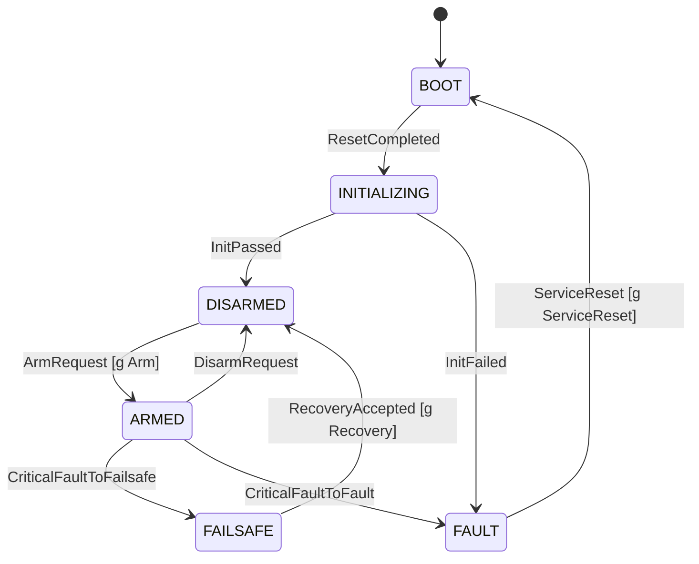

# DC-17: STA-01 States and transition table — Design

| Field | Value |
|---|---|
| Jira | DC-17: STA-01: States and transition table |
| Story | STA-01, M, P0 (from backlog) |
| SRS requirements | FR-030, FR-031; constraints: FR-002, FR-061, FR-067, FR-051, FR-054, NFR-016, NFR-005, NFR-006, NFR-008, NFR-009, FR-070, NFR-017 |
| Depends on | DSN-01 (doc not present yet, see OQ-1), FND-03 (harness present in `tests/unit/harness/`) |
| Blocks | STA-02, STA-03, STA-04, STA-05, SAF-01, SAF-03, SAF-04 (direct); STA-06, SAF-05, APP and COM stories transitively |
| Status | Draft |

## 1. Summary and scope

Implement the six flight states (BOOT, INITIALIZING, DISARMED, ARMED, FAILSAFE, FAULT) and a data-driven transition table that reproduces SRS section 10. The current state changes only inside one dispatch function, and only by following a table row. Every other (state, event) pair is rejected with no state change.

In scope:
- State and event enumerations, the constant transition table, the dispatch function, the outcome type.
- Guard hook interface with a deny-by-default stub for the three guarded rows.
- A per-row `behavior` tag copied from the SRS "Required behavior" column, as data for downstream consumers.

Out of scope (owned elsewhere, see section 2.1): pre-arm checks, disarm handling, mode registry, init sequencing, safety gate, fault-class mapping, recovery acceptance, status snapshot, MAVLink parsing.

This story performs no actuator action. It never touches `IActuator` or the safety gate.

## 2. Requirement analysis

| ID | Short text | Source | How addressed | TC ID |
|---|---|---|---|---|
| FR-030 | Explicit states BOOT, INITIALIZING, DISARMED, ARMED, FAILSAFE, FAULT | SRS 7.4; STA-01 | `FlightState` enum with exactly these six values; no other value is representable as valid (4.1). | TC-STATE-002 |
| FR-031 | Transitions defined and validated against an explicit table | SRS 7.4; STA-01 | Constant table `kTransitionTable` is the only source of `to` states; dispatch looks up (state, event) and rejects on miss (4.2). | TC-STATE-002, TC-STATE-003 |
| FR-002 | Outputs inhibited from reset until init and safety checks complete | SRS 7.1 | Initial state is BOOT with no setter. No row reaches ARMED except D4 from DISARMED. Output inhibit itself is enforced by the safety gate (SAF-01, `TC-BOOT-001`). | TC-STATE-003 (no path to ARMED from BOOT/INITIALIZING); TC-BOOT-001 (SAF-01) |
| FR-061 | Outputs inhibited in boot, init, disarmed, fault | SRS 7.7 | Rows into and within these states carry `behavior = KeepInhibited` as data. Enforcement is SAF-01. | TC-STATE-002 (tag check); TC-BOOT-001 (SAF-01) |
| FR-067 | Recovery needs explicit validated conditions; no automatic re-arm | SRS 7.7 | No row has `to = ARMED` except D4 (from DISARMED). FAILSAFE only reaches DISARMED (D8); FAULT only reaches BOOT (D9). D8 and D9 are guarded with deny-by-default. Guard content is SAF-05. | TC-STATE-003; TC-STATE-007 (SAF-05) |
| FR-051 | MAVLink: parse only supported messages, validate length, source, params | SRS 7.6 | Boundary only: the state machine accepts typed internal events, never raw MAVLink bytes. Validation lives in COM stories. | TC-STATE-003 (invalid input case); TC-COMM-001 (COM) |
| FR-054 | Unsupported commands rejected without changing actuator state | SRS 7.6 | An unsupported command never becomes an event. An event outside the enum range is rejected as `RejectedInvalidInput` with no state change. | TC-STATE-003 |
| NFR-016 | Malformed/unexpected input fails safely | SRS 8 | Out-of-range state or event values are rejected; no state change (4.3). | TC-STATE-003 |
| NFR-005 | No dynamic allocation in runtime paths | SRS 8 | Table is `constexpr` static data; lookup is a bounded scan; no heap. | TC-CI-002 (FND-07) |
| NFR-008 | Core independent of STM32 HAL and FreeRTOS | SRS 8 | Header-only dependencies on the C++ standard library; no platform includes. | TC-CI-002 (FND-07) |
| FR-070 | Core builds for desktop host | SRS 7.8 | Sources added to `dfcs_core`; tests build under host CMake. | TC-CI-004 (FND-01) |
| NFR-006 | Shared data uses documented sync and ownership rules | SRS 8 | Ownership stated in 4.1; synchronization is TBD (4.4). | — (Review, per SRS 8) |
| NFR-009 | Clear ownership of mutable data | SRS 8 | One writer (`dispatch`), const reader. | — (Review, per SRS 8) |
| NFR-017 | No flightworthiness claim | SRS 8 | Nothing in this design claims flightworthiness (section 3). | — (Documentation review, per SRS 8) |

### 2.1 Related requirements enforced by other stories

| Requirement | Enforced by | Owner TC | Hook defined here |
|---|---|---|---|
| FR-032 pre-arm checks | STA-02 | TC-STATE-001 | Arm guard (`GuardId::Arm`) |
| FR-034 disarm handling | STA-03 | TC-STATE-004 | None. Row D6 is unguarded. |
| FR-033, FR-036 mode validation | STA-04 | TC-STATE-005 | None |
| FR-001, FR-003 init sequence, init failure | STA-05 | TC-BOOT-002, TC-BOOT-003 | None. STA-05 emits `InitPassed` / `InitFailed`. |
| FR-035 status snapshot | STA-06 | TC-STATE-006 | `DispatchResult` carries the data STA-06 needs |
| FR-002, FR-046, FR-061 output inhibit | SAF-01 | TC-BOOT-001, TC-SAFE-002 | `behavior` tag only |
| FR-063, FR-066 fault class to FAILSAFE/FAULT | SAF-03, SAF-04 | TC-SAFE-004 | Two critical-fault events (D7a, D7b) |
| FR-067 recovery acceptance | SAF-05 | TC-STATE-007 | Recovery guard (`GuardId::Recovery`) |

## 3. Assumptions, constraints, out of scope

- All names below (`FlightState`, `FlightEvent`, `kTransitionTable`, `GuardId`, `IStateGuard`, `DispatchResult`, file names) are proposed and may be renamed by DSN-01 (OQ-1).
- The state model is a logical software model, not a flight-mode specification (SRS 10).
- Single-threaded caller assumed; concurrency is TBD (4.4).
- No timing, stack, or memory figures are stated here (SRS 8).
- This is a POC for simulation and propulsion-disabled bench only. No claim of flightworthiness or certification (NFR-017).
- Out of scope: any transition not in SRS 10 (see OQ-3, OQ-4).

## 4. Design

### 4.1 Modules and interfaces (ports, mutable-data ownership)

Proposed files (host-buildable, added to `dfcs_core` in `firmware/core/CMakeLists.txt`):
- `firmware/core/include/flight_state.hpp`: enums, `TransitionRow`, `DispatchResult`, `IStateGuard`, `FlightStateMachine`.
- `firmware/core/src/flight_state_table.cpp`: `kTransitionTable`.
- `firmware/core/src/flight_state_machine.cpp`: dispatch.
- `tests/unit/state/` (GoogleTest): TC-STATE-002 and TC-STATE-003.

Types:

```text
enum class FlightState { Boot, Initializing, Disarmed, Armed, Failsafe, Fault }       // FR-030
enum class FlightEvent {
  ResetCompleted, InitPassed, InitFailed, ArmRequest, DisarmRequest,
  CriticalFaultToFailsafe, CriticalFaultToFault, RecoveryAccepted, ServiceReset }
enum class GuardId { None, Arm, Recovery, ServiceReset }
enum class Behavior { KeepInhibited, KeepInhibitedReportFault, EnableControlPathUnderLimits,
                      InhibitNormalCommands, ApplyDefinedSafetyResponse, NeverAutoRearm }
enum class Outcome { Accepted, RejectedNotPermitted, RejectedGuardDenied, RejectedInvalidInput }

struct TransitionRow { FlightState from; FlightEvent event; GuardId guard;
                       FlightState to; Behavior behavior; };

struct GuardResult { bool allowed; uint16_t reason; };   // reason: opaque, code set owned by STA-02 (OQ-5)

class IStateGuard { public: virtual GuardResult evaluate(FlightState, FlightEvent) const = 0; };

struct DispatchResult { Outcome outcome; FlightState from; FlightState to;
                        int8_t row;       // table row index, -1 if none
                        uint16_t reason;  // guard reason, 0 if none
                        Behavior behavior; };

class FlightStateMachine {
 public:
  FlightStateMachine();                                   // state = Boot, all guards unwired
  FlightState state() const;                              // sole reader accessor
  void setGuard(GuardId, const IStateGuard*);             // wiring at init only; NOT a state setter
  DispatchResult dispatch(FlightEvent);                   // sole writer of state
};
```

`Behavior` values map to the SRS 10 "Required behavior" column (D7a/D7b share `ApplyDefinedSafetyResponse`). `behavior` in `DispatchResult` is meaningful only when `outcome == Accepted`; rejected results leave it unset. Reporting a rejection reason to telemetry is STA-06.

Mutable-data ownership:
- `FlightStateMachine::state_` is private. Written only inside `dispatch()` after a successful table match and guard allow. There is no `setState`. Readers use `state()` (const) or the `DispatchResult` copy.
- `kTransitionTable` is `constexpr`, immutable.
- Guard pointers are written only through `setGuard()` during wiring (single writer: application wiring). A null pointer means unwired.
- Default stub: `DenyAllGuard` returns `{allowed=false, reason=0}`. Guard pointers default to null, which `dispatch()` treats as denied (fail closed).

Guards must be side-effect-free (`const`) and are called only after a table match.

### 4.2 Data flow and state interaction

Data flow: `event source (STA-05, STA-02/COM arm path, STA-03 disarm path, SAF-04, SAF-05) -> FlightStateMachine::dispatch -> DispatchResult -> consumers (SAF-01 gate, STA-06 snapshot)`. This is the "Flight-State Manager" element of SRS 4.3.

SRS section 10 row mapping (design rows are numbered D1 to D9; the SRS has 9 rows):

| Design row | SRS 10 row | From | Event | Guard | To | Behavior | Note |
|---|---|---|---|---|---|---|---|
| D1 | 1 | BOOT | ResetCompleted | None | INITIALIZING | KeepInhibited | |
| D2 | 2 | INITIALIZING | InitPassed | None | DISARMED | KeepInhibited | STA-05 emits event only after init and checks pass |
| D3 | 3 | INITIALIZING | InitFailed | None | FAULT | KeepInhibitedReportFault | |
| D4 | 4 | DISARMED | ArmRequest | Arm | ARMED | EnableControlPathUnderLimits | Guard owner STA-02 |
| D5 | 5 | DISARMED | ArmRequest | Arm denied | DISARMED | reject, report reason | Not a table row: D5 is the guard-denied branch of D4 (see below) |
| D6 | 6 | ARMED | DisarmRequest | None | DISARMED | InhibitNormalCommands | STA-03 adds signalling to the gate |
| D7a | 7 | ARMED | CriticalFaultToFailsafe | None | FAILSAFE | ApplyDefinedSafetyResponse | Split of SRS row 7 |
| D7b | 7 | ARMED | CriticalFaultToFault | None | FAULT | ApplyDefinedSafetyResponse | Split of SRS row 7 |
| D8 | 8 | FAILSAFE | RecoveryAccepted | Recovery | DISARMED | NeverAutoRearm | Guard owner SAF-05 |
| D9 | 9 | FAULT | ServiceReset | ServiceReset | BOOT | KeepInhibited | Guard owner unresolved (OQ-4) |

Split and merge decisions:
- SRS row 5 ("invalid arm request": DISARMED to DISARMED, reject and report reason) is not a separate table row. A table row with `to == from` would let a table lookup produce "accepted" for a rejection. Instead, any guarded row whose guard denies yields `RejectedGuardDenied` and no state change. This applies equally to D4, D8, D9. The SRS behavior is preserved (state stays DISARMED, reason reported). TC-STATE-002 still covers it as a named case.
- SRS row 7 ("FAILSAFE or FAULT") is split into D7a and D7b, keyed by two events, because choosing the target is a fault-class decision owned by SAF-03/SAF-04. STA-01 does not choose (OQ-2).
- Table rows: D1 to D4 and D6 to D9 with D7 split, giving 9 table rows and 9 permitted (state, event) pairs (D4 and D5 share one pair). Total pairs are 6 states x 9 events = 54. Non-permitted pairs: 45.

State diagram (permitted transitions; guarded edges marked `[g]`):



Dispatch algorithm:
1. If the event value is outside the `FlightEvent` enumerators, or the stored state is outside the `FlightState` enumerators, return `RejectedInvalidInput`. No state change.
2. Scan `kTransitionTable` for a row with `from == state_` and `event == event`. Rows are unique per (from, event) pair.
3. No row: return `RejectedNotPermitted`. No state change. Guards are not called.
4. Row found with `guard == None`: go to step 7.
5. Row found with a guard: look up the guard pointer. If null, return `RejectedGuardDenied` (reason 0). No state change.
6. Call `evaluate(state_, event)`. If `allowed == false`, return `RejectedGuardDenied` with the guard's reason. No state change.
7. Set `state_ = row.to`. Return `Accepted` with `from`, `to`, row index, `behavior`.

The three rejection outcomes are distinct enumerators so tests can assert each: not permitted (step 3), guard denied (steps 5, 6), invalid input (step 1).

### 4.3 Error, fault, and failsafe handling

- Outputs inhibited by default (FR-002, FR-061): the machine starts in BOOT, with no setter and no constructor argument for the initial state. The only row that leads to ARMED is D4, from DISARMED, behind the Arm guard. Unwired Arm guard denies. Actual output inhibition is SAF-01 (`TC-BOOT-001`); the `behavior` tag only carries the SRS column.
- No automatic re-arm (FR-067): FAILSAFE and FAULT have no row to ARMED. FAILSAFE leads only to DISARMED (D8), FAULT only to BOOT (D9); both guarded and deny by default. Fault clearing is not an event in this table, so clearing a fault cannot move state by itself. The recovery guard content and `TC-STATE-007` belong to SAF-05.
- MAVLink input (FR-051, FR-054, NFR-016): the state machine never sees MAVLink bytes. COM stories parse and validate and turn only supported, valid commands into `FlightEvent`s. An unsupported or malformed command produces no event, so it cannot change state or actuators. An event or state value outside its enum is `RejectedInvalidInput`.
- Invalid input: `RejectedInvalidInput`, no state change, no guard call.
- Unwired dependency: a null guard pointer is treated as deny (`RejectedGuardDenied`). Until STA-02, SAF-05 and the D9 owner wire real guards, D4, D8 and D9 cannot succeed. This is intended fail-closed behavior.
- Critical fault: D7a/D7b are taken only when SAF-04 emits the event. If SAF-04 is not wired, ARMED is not left by fault in this story. That gap is owned by SAF-04 and is why the stories are ordered STA-01 before SAF-04.
- No retries, no fallback, no implicit transitions.

### 4.4 Timing, memory, concurrency (TBD only)

- Execution time of `dispatch()`: TBD (measured), OD-012, DSN-02.
- Static memory footprint of table and class: TBD (measured), OD-012.
- Call context and synchronization of `dispatch()` and `state()` between tasks and interrupts: TBD (design decision), DSN-02 (NFR-006). Until DSN-02 states it, callers must use one context.

## 5. Test plan

Host-only. Expected values in tests are written out by hand from SRS 10, not read from `kTransitionTable`, so a wrong table entry is caught.

| TC ID | Purpose | Framework | Requirement |
|---|---|---|---|
| TC-STATE-002 | Case per permitted row: D1, D2, D3, D6, D7a, D7b accepted from the expected `from` state to the expected `to` state and `behavior`. | GoogleTest | FR-030, FR-031 |
| TC-STATE-002 | D4, D8, D9 with a test guard that allows: accepted, correct `to` state, `behavior`. | GoogleTest | FR-031, FR-067 |
| TC-STATE-002 | SRS row 5 case: ArmRequest in DISARMED with a guard that denies returns `RejectedGuardDenied`, state stays DISARMED, guard reason is passed through. | GoogleTest | FR-031 |
| TC-STATE-002 | Table structure: no duplicate (from, event) keys; every `from`/`to` is a valid enumerator; exactly 9 permitted pairs; `to == Armed` appears only in D4. | GoogleTest | FR-030, FR-031, FR-067 |
| TC-STATE-003 | All 45 non-permitted (state, event) pairs, generated as the cross product of the six states and nine events minus the 9 permitted pairs: each returns `RejectedNotPermitted`, `state()` unchanged, guard not called. State is forced into each start state by a permitted path through the public API, not by a setter. | GoogleTest | FR-031 |
| TC-STATE-003 | Guarded rows D4, D8, D9 with deny guard and with unwired guard: `RejectedGuardDenied`, state unchanged. | GoogleTest | FR-031, FR-067 |
| TC-STATE-003 | Out-of-range event value (cast): `RejectedInvalidInput`, state unchanged, guard not called. | GoogleTest | FR-054, NFR-016 |
| TC-STATE-003 | From FAILSAFE and FAULT, every event other than the permitted one leaves state unchanged, and none reaches ARMED. | GoogleTest | FR-067 |
| TC-STATE-003 | The three rejection outcomes are mutually distinguishable (one assertion on each enumerator). | GoogleTest | FR-031 |

Dependencies for the tests: FND-03 harness (`tests/unit/CMakeLists.txt` already registers GoogleTest). Related TCs owned elsewhere and not run here: TC-STATE-001 (STA-02), TC-STATE-004 (STA-03), TC-STATE-007 (SAF-05), TC-BOOT-001 (SAF-01), TC-CI-002 (FND-07), TC-CI-004 (FND-01).

## 6. Traceability (RTM rows to add or update)

`docs/traceability/RTM.md` does not exist yet (FND-08). When it exists:

| Requirement ID | Requirement summary | Design component | Test case ID | Status | Evidence |
|---|---|---|---|---|---|
| FR-030 | Explicit flight states | `FlightState`, `FlightStateMachine` (DC-17 section 4.1) | TC-STATE-002 | Planned | Pending |
| FR-031 | Transition table validation | `kTransitionTable`, `dispatch()` (DC-17 section 4.2) | TC-STATE-002, TC-STATE-003 | Planned | Pending |

The SRS 17 seed row maps FR-030 to `TC-STATE-001`, but the backlog assigns `TC-STATE-001` to FR-032 (OQ-7). Update the FR-030 row to TC-STATE-002 once the mismatch is resolved. Add DC-17 section references for NFR-006 and NFR-009 once DSN-01 exists.

## 7. Risks and open questions

Risks:
- R-1: Names and file layout may clash with DSN-01. Mitigation: all names flagged as proposed; the change is mechanical.
- R-2: Deny-by-default guards mean D4, D8, D9 cannot succeed until later stories wire real guards. Mitigation: intended fail-closed; tests use fake guards; each owner story has a TC.
- R-3: Splitting SRS row 7 by event moves the FAILSAFE/FAULT decision to SAF-04. Mitigation: OQ-2; STA-01 adds nothing to it.
- R-4: SRS 10 does not cover a critical fault outside ARMED. Mitigation: not invented here; OQ-3.
- R-5: Rejection of every unlisted pair means disarm in DISARMED or arm in ARMED is `RejectedNotPermitted`, which STA-03 may want to treat as a handled no-op. Mitigation: STA-03 maps the outcome; the table does not change.

Open questions:
1. OQ-1 (owner: DSN-01 author): `docs/design/` is empty, so DSN-01 (module list, ownership table, `step(now)` entry point, fault reporting convention) does not exist. Confirm the namespace, file layout and naming used in 4.1, or provide the doc.
2. OQ-2 (owner: SAF-03): Confirm that SRS row 7 ("FAILSAFE or FAULT") is split into two events chosen by the fault-class table, rather than one event plus a resolver hook inside the state machine.
3. OQ-3 (owner: SAF-03, SRS owner): SRS 10 defines no transition for a critical fault in INITIALIZING, DISARMED or FAILSAFE (for example FAILSAFE to FAULT). Today those pairs are rejected. Is that intended, or does SRS 10 need extra rows?
4. OQ-4 (owner: SAF-05 or SRS owner): SRS row 9 (FAULT to BOOT, "reset/service recovery procedure") has no owning story or guard definition. SAF-05 covers only recovery to DISARMED. Who owns the `ServiceReset` guard and its test, and what does "service recovery" require?
5. OQ-5 (owner: STA-02, COR-03): Type and code set of the rejection reason. This design passes an opaque `uint16_t` through. Confirm the type before STA-02 and STA-06.
6. OQ-6 (owner: reviewer): Confirm modeling SRS row 5 as the generic guard-denied branch rather than a separate table row, and that "invalid arm request" in SRS row 5 means pre-arm guard denial only (malformed requests are rejected upstream and never reach the state machine).
7. OQ-7 (owner: SRS/backlog owner): ID mismatch. SRS 17 maps FR-030 to `TC-STATE-001` and SRS 11.3 describes it as arming rejection; the backlog uses `TC-STATE-001` for FR-032 and `TC-STATE-002/003` for FR-030/031. Also, `docs/test-specifications/` and the RTM do not exist (FND-08), so TC-STATE-002 and TC-STATE-003 procedures cannot be recorded yet.
8. OQ-8 (owner: DSN-02): Which context calls `dispatch()` and who calls `ResetCompleted`? Needed to settle 4.4.

## 8. Definition of Done checklist (SRS 18)

- [ ] Implementation and interface reviewed (Doc: this design; code: pending).
- [ ] TC-STATE-002 and TC-STATE-003 present and passing (host).
- [ ] Static-analysis findings resolved or dispositioned (clang-tidy, cppcheck, per NFR-012).
- [ ] Traceability updated (RTM absent; see section 6, OQ-7).
- [ ] Design and user documentation updated (this document; DSN-01 reconciliation, OQ-1).
- [ ] CI checks pass (format, static analysis, host build, FND-07 banned-API check).
- [ ] Test evidence retained.
- [ ] Safety impact reviewed: fail-closed rejection, no re-arm path, no actuator access (section 4.3); fault-class decisions deferred to SAF-03/SAF-04.
